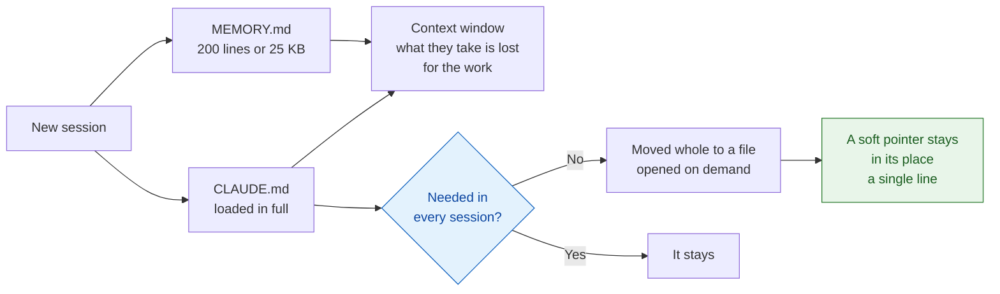

Versión en español: [README.md](README.md)

# claude-code-context-management

> Vigencia.** Verificado contra la documentación oficial de Anthropic el **16 de julio de

### The problem

Picture a desk of fixed size. Everything you want an assistant to bear in mind while it works has
to be on that desk, because whatever does not fit does not exist for it. It does not work like a
person's memory, rummaging for whatever is relevant: it is a surface read whole, at a glance,
every time the assistant sits down.

Add two details to the picture. The desk is cleared at the end of the day, so tomorrow you have to
put back whatever is needed. And the sheets you leave on it before starting take up room you will
no longer have for the day's work.

That desk is called the **context window**, and the **context** is what sits on it: all the text
the assistant has in front of it while reasoning, the instructions you wrote plus the conversation
you are having. It is the least known limitation of these programs. Many people assume the
assistant learns from one session to the next, when no learning of that kind takes place.

So far it looks like the answer is writing it plenty of sheets, and here comes the part almost
nobody expects: the more instructions you give it, **the less attention it pays to each one**.
Anthropic, the company that builds Claude Code, says so in its documentation in one line: *"Longer
files consume more context and reduce adherence."* Longer files eat more context and reduce
adherence, meaning the degree to which the assistant follows what you wrote.

Claude Code loads two **context files** by itself at the start of every session, a context file
being a sheet of instructions the tool puts on the desk without being asked:

- **`CLAUDE.md`**: you write it, with the project conventions and the warnings that prevent
  expensive mistakes. It loads in full, whatever its length.
- **`MEMORY.md`**: the assistant writes it alone, noting what it learns from your corrections. Of
  this one, the first 200 lines or the first 25KB load, whichever comes first.

Both grow, because everyone adds and almost nobody removes.

### An example

The move is always the same. This used to sit inside the file that loads in every session, taking
up thirty lines:

```
## Database tables
| Table     | What it holds         | Critical fields      |
|-----------|-----------------------|----------------------|
| customers | ...                   | ...                  |
| invoices  | ...                   | ...                  |
(twenty-eight more rows)
```

And what took its place in that same spot occupies a single line:

```
Inventory of tables and fields: `detalle_datos.md`. Not loaded at startup; open it when needed.
```

That line is a **soft pointer**: a sentence saying, in effect, "for this, look there". The whole
inventory travelled to `detalle_datos.md`, which the assistant opens only when it needs it. It
travelled whole and left no copy behind, the rule people skip most often.

With twenty moves like that one, the `CLAUDE.md` of a real project went from **257 lines** to
**200**, landing on Anthropic's official target. Its `MEMORY.md` stands today at **158 lines and
20.4KB**, inside the cut of 200 lines or 25KB, though already at four fifths of the size limit.

All three figures were measured on 22/07/2026 with four different ways of counting that agree. The
check earns its keep: a fifth way of counting returned 153, because it was counting something else
(lines with text on them, skipping the blank ones). Two methods are worth having when they count
the same thing.



### Why we measure live instead of quoting from memory

The previous version of this front page said that `CLAUDE.md` had been brought "below 150 lines".
Today it is 200. The figure was true the day it was written and aged on its own, while the
repository itself preached measuring live instead of quoting from memory.

It is written here because it is the best demonstration of the thesis. A figure typed by hand into
a context file expires the moment somebody edits that file, and nothing warns you.

### The concepts

**Guidance rather than orders.** Both files are suggestions the assistant tries to follow, and the
official documentation is blunt: *"Claude treats them as context, not enforced configuration."* If
you need something obeyed no matter what, a context file will not do it.

**Truncation.** To **truncate** is to cut off whatever does not fit. Of `MEMORY.md`, the first 200
lines or the first 25KB load, and the rest stays out. Until recently nothing flagged what was left
out, hence the repository's insistence on keeping a buffer below the limit rather than grazing it.
That point has changed. It is covered further down.

**On demand.** A file loads **on demand** when it does not come in at startup and the assistant
opens it only if it needs it. That is the whole mechanism: moving the detail somewhere that is not
read every day.

**A single source of truth.** When a block leaves the main file, it leaves whole and the pointer
stays in its place. It is never copied. Anyone who has kept two versions of the same contract
knows why: two files saying the same thing are two places to correct, you fix one, you forget the
other, and you end up with two texts contradicting each other without the assistant knowing which
one holds. Sometimes it obeys the old one.

**Intent against mechanism.** Writing "these files must be kept short" is an intent. Putting in a
program that measures them and warns when they overflow is a mechanism. This repository asks for
the second, while warning that a watchdog grants false confidence: it checks the size, with no way
to judge whether the content is any use.

**Hook and skill.** A **hook** is a small program the tool runs by itself at a fixed moment, for
instance every time a file is saved, without anyone having to remember to launch it. A **skill**
is a bundle of instructions the tool loads only when the task calls for it. Both appear in the
repository as ways of taking weight off the startup load.

### The protocol in six steps

This is how a block of text travels, start to finish, with the step by step detail in the
[How we manage it](docs/09_como_lo_gestionamos.md) document of the repository.

1. **A dated backup.** These files shape the assistant's behaviour in every session that follows.
2. **Measure live, with two methods.** A figure typed by hand expires the moment you edit.
3. **Decide what leaves.** It all reduces to one question: can the assistant find this out on its
   own, by reading the project? If the answer is yes, it is an inventory and it is surplus.
4. **Move it whole and leave a pointer.** The block travels complete to the detail file.
5. **Verify zero losses.** Source is compared against destination at every move, with a result of
   zero missing.
6. **Put in a watchdog.** A program that measures and turns red by itself, so nobody has to
   remember to look.

The third is the one most people skip, and also the one the academic study cited below supports:
summaries and dependency lists do not help, because the assistant already infers them from the
project. The only thing that pays is what cannot be inferred from anywhere, of the kind "this
account goes here and not there".

### What Anthropic says vs what we add

The rule of the whole repository: separate the official fact from our own convention.
Anthropic sets the limits and gives the paths; the discipline layered on top of them is ours.

| Topic | Official Anthropic (verified 16/07/2026) | Our convention |
|-|-|-|
| `CLAUDE.md` size | Target *"under 200 lines"*. Loads in full, whatever its length. | The 200 target is measured live, with two methods that agree. |
| `MEMORY.md` size | The *"first 200 lines or 25KB, whichever comes first"* load. The rest does not. | A buffer below the limit, so we never graze it. |
| `@import` | Imported files *"still load and enter the context window at launch"*. No context saved. | Rule: never `@import` to save weight. It only organizes. |
| Secondary files | Topic files (like `debugging.md`) *"are not loaded at startup. Claude reads them on demand"*. Official offload paths: `.claude/rules/` with `paths`, and skills. | A soft pointer to a detail file, as an alternative. |
| A custom third file | Only `CLAUDE.md`, `CLAUDE.local.md`, `.claude/rules/` and `MEMORY.md` autoload. An invented `context.md` would not load. | We studied it and dropped it. Explained in `docs/`. |

### What is in this repository

Eleven documents with their licence, without a single program to launch.

- **[01. The two files](docs/01_los_dos_ficheros.md)**: what each is, who writes it, when it loads.
- **[02. Size and limits](docs/02_tamano_y_limites.md)**: the official figures and why size matters.
- **[03. Pointers and secondary files](docs/03_punteros_y_secundarios.md)**: how to offload weight to files read only when needed.
- **[04. `@import` dropped](docs/04_import_descartado.md)**: what `@import` is, when it helps, why we do not use it to lighten load.
- **[05. Why not a third file](docs/05_por_que_no_un_tercer_fichero.md)**: why we dropped creating a `context.md`.
- **[06. All the official paths](docs/06_vias_oficiales_completas.md)**: every official mechanism, not just the ones we use.
- **[07. The hook](docs/07_hooks.md)**: the hook as a related mechanism, its usefulness here weighed.
- **[08. Why it works](docs/08_por_que_funciona.md)**: the theory behind the architecture.
- **[09. How we manage it](docs/09_como_lo_gestionamos.md)**: the practical protocol, step by step.

*(The docs are written in Spanish.)*

### What has been checked

There is nothing to run here, so what can be measured is something else: how much of what it
claims is backed by the official documentation it cites, and whether that documentation says today
what the repository says it says. Counted one by one, there are **twelve literal quotes** in
English attributed to Anthropic, spread over seventeen appearances. All twelve were checked on
22/07/2026 against the live page.

| Check | Result |
|---|---|
| The twelve quotes, word by word | ten identical; two compressed |
| The twelve quotes, in the substance of what they claim | all twelve correct |
| The official page cited eleven times | exists and still stands |
| The three sibling repositories it links | all three exist |
| Claims without official backing | labelled as our own convention |

Compressing changed the meaning in neither case. Where the repository quotes *"first 200 lines or
25KB, whichever comes first"*, the official page spreads those words across two different places,
without putting them in a row.

### What has already expired

**Silent truncation has stopped being silent.** The repository was verified on 16/07/2026 and
claimed twice that the `MEMORY.md` cut comes with no warning. The official page documents the
opposite today: since version 2.1.210 the tool measures that file every time the assistant writes
to it, reminds it to shorten if it approaches the limit and returns an error if it has gone over.
Six days between one thing and the other. The advice to keep a buffer still holds on size grounds;
the argument that nobody warns you does not.

**This repository's own figure.** Told above: "below 150" measured 200.

**The study, now with a name.** The previous front page invoked an academic study four times
without naming it once, which left no reader able to check it. It is *Evaluating AGENTS.md: Are
Repository-Level Context Files Helpful for Coding Agents?*, by Gloaguen, Mündler, Müller, Raychev
and Vechev, of the Swiss Federal Institute of Technology in Zurich. They put hundreds of real
coding tasks through several of these assistants, sometimes with an instruction sheet and
sometimes without. The result is uncomfortable: the sheet does not improve results in general and
it raises the cost of each task by more than 20%.

### Its limits

**It is a photograph with a date.** The reasoning it explains lasts; the numbers it gives expire.
The safe use of its figures runs through checking them one by one, and the previous section shows
at what speed that is needed.

**It does not bring the watchdog it recommends.** Step 6 of the protocol asks for a program that
measures the files and warns by itself. There is none here, so whoever applies the method has to
write it.

**The study measured coding tasks.** Outside that ground, the backing becomes a reasonable
analogy.

**It applies to Claude Code.** Other tools load other files with other limits, though the
underlying reasoning carries over.

### Related repos

This repository tells one piece of a larger system:

- **[agent-memory-governance](https://github.com/jleonceo/agent-memory-governance)**: the sibling.
  That one governs the quality of what is remembered, so the memory corpus does not rot, with a
  linter, logs and re-runnable citations. This one governs the loading budget: how much of that
  memory reaches the context each session.
- **[gobernanza-agentes-verificada](https://github.com/jleonceo/gobernanza-agentes-verificada)**:
  the kit that measures whether an agent system is still the one you built, with read-only
  detectors. The mechanism recommended here, written for another problem.
- **[verificacion-determinista-ia](https://github.com/jleonceo/verificacion-determinista-ia)**:
  code that re-checks the coherence of the state without AI.
- **[gobernanza-skills-analiticas](https://github.com/jleonceo/gobernanza-skills-analiticas)**:
  golden sets, regression gates, autonomy by risk.

### Sources

- Anthropic official documentation, Claude Code, *Memory*:
  <https://code.claude.com/docs/en/memory> (accessed 16/07/2026, reviewed 22/07/2026).
- Gloaguen, Mündler, Müller, Raychev and Vechev, *Evaluating AGENTS.md: Are Repository-Level
  Context Files Helpful for Coding Agents?*, Swiss Federal Institute of Technology in Zurich.

Everything marked official comes from the first, with its literal quote. The rest is our own
convention, labelled as such wherever it is claimed.

---

*MIT licence.*
