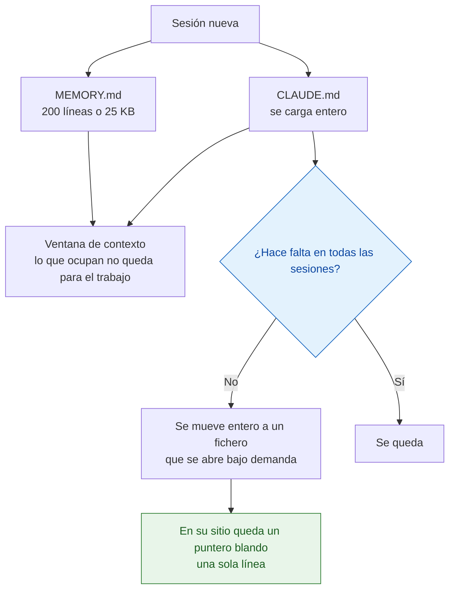

English version: [README.en.md](README.en.md)

# claude-code-context-management

**Un asistente de IA no recuerda nada de una sesión a la siguiente, así que alguien tiene que
decidir qué se le vuelve a poner delante cada mañana. Lo que se le pone ocupa el sitio del trabajo
del día. Este repositorio explica cómo se decide eso, con la documentación oficial de Anthropic
por un lado y la convención propia por otro, siempre separadas.**


> 2026** y revisado el 22 de julio. Esto puede cambiar: Claude Code evoluciona rápido, y este
> mismo documento tiene abajo un apartado con lo que se le ha caducado en seis días.

### El problema

Imagina un escritorio de tamaño fijo. Todo lo que quieras que un ayudante tenga en cuenta mientras
trabaja tiene que estar encima de ese escritorio, porque lo que no cabe, para él no existe. No
funciona como la memoria de una persona, que rebusca y saca lo que viene al caso: es una
superficie que se lee entera, de un vistazo, cada vez que el ayudante se sienta.

Añade dos detalles a la imagen. El escritorio se vacía al acabar la jornada, de manera que mañana
hay que volver a poner encima lo que haga falta. Y las hojas que dejes puestas antes de empezar
ocupan un sitio que ya no tendrás para el trabajo del día.

A ese escritorio se le llama **ventana de contexto**, y el **contexto** es lo que hay encima:
todo el texto que el asistente tiene delante mientras razona, con las instrucciones que le
escribiste y la conversación que lleváis. Es la limitación menos conocida de estos programas.
Mucha gente supone que el asistente aprende de una sesión a otra, y no aprende.

Hasta aquí parece que la solución sea escribirle muchas hojas, y aquí viene la parte que casi
nadie espera: cuantas más instrucciones le pones, **menos caso hace a cada una**. Anthropic, la
empresa que fabrica Claude Code, lo dice en su documentación con una línea: *"Longer files consume
more context and reduce adherence."* Los ficheros más largos consumen más contexto y reducen la
adherencia, esto es, el grado en que el asistente sigue lo que le has escrito.

Claude Code carga solo dos **ficheros de contexto** al empezar cada sesión, entendiendo por eso
las hojas de instrucciones que la herramienta pone en el escritorio sin que se lo pidas:

- **`CLAUDE.md`**: lo escribes tú, con las convenciones del proyecto y los avisos que evitan
  errores caros. Se carga entero, mida lo que mida.
- **`MEMORY.md`**: lo escribe el asistente solo, anotando lo que aprende de tus correcciones. De
  este entran las primeras 200 líneas o los primeros 25 KB, lo que llegue antes.

Los dos engordan, porque todo el mundo añade y casi nadie quita.

### Un ejemplo

El movimiento es siempre el mismo. Esto estaba dentro del fichero que se carga en todas las
sesiones, ocupando treinta líneas:

```
## Tablas de la base de datos
| Tabla     | Qué guarda            | Campos críticos      |
|-----------|-----------------------|----------------------|
| clientes  | ...                   | ...                  |
| facturas  | ...                   | ...                  |
(veintiocho filas más)
```

Y en el mismo sitio quedó lo siguiente, que ocupa una sola línea:

```
Inventario de tablas y campos: `detalle_datos.md`. No se carga al arrancar; ábrelo cuando toque.
```

Esa línea es un **puntero blando**: una frase que dice, en la práctica, "para esto, mira allí".
El inventario entero viajó a `detalle_datos.md`, que el asistente abre solo cuando lo necesita.
Viajó completo y sin dejar copia, que es la regla que más se salta la gente.

Con veinte movimientos como ese, el `CLAUDE.md` de un proyecto real pasó de **257 líneas** a
**200**, con el objetivo oficial de Anthropic puesto justo ahí. Su `MEMORY.md` va hoy por **158
líneas y 20,4 KB**, dentro del corte de 200 líneas o 25 KB, aunque ya en cuatro quintas partes del
límite de tamaño.

Las tres cifras están medidas el 22/07/2026 con cuatro formas distintas de contar que coinciden.
La comprobación no sobra: una quinta forma de contar devolvió 153, porque estaba contando otra
cosa (las líneas con texto, saltándose las vacías). Dos métodos solo sirven de comprobación
cuando los dos cuentan exactamente lo mismo.



### Por qué se mide en vivo y no de memoria

La versión anterior de esta portada decía que ese `CLAUDE.md` se había dejado "por debajo de 150
líneas". Hoy son 200. La cifra era cierta el día que se escribió y envejeció sola, mientras el
propio repositorio predicaba medir en vivo en lugar de citar de memoria.

Queda escrito aquí porque es la mejor demostración de la tesis. Una cifra escrita a mano en un
fichero de contexto caduca en cuanto alguien edita el fichero y nada avisa.

### Los conceptos

**Guía, no orden.** Los dos ficheros son sugerencias que el asistente intenta seguir, y la
documentación oficial es tajante: *"Claude treats them as context, not enforced configuration."*
Si necesitas que algo se cumpla pase lo que pase, un fichero de contexto no sirve.

**El truncado.** **Truncar** es cortar por lo sano lo que no cabe. Del `MEMORY.md` entran las
primeras 200 líneas o los primeros 25 KB y el resto se queda fuera. Hasta hace poco nada marcaba
lo que quedaba fuera, de ahí la insistencia del repositorio en dejar un colchón por debajo del
límite en vez de rozarlo. Ese punto ha cambiado. Está contado en el apartado de más abajo.

**Bajo demanda.** Un fichero se carga **bajo demanda** cuando no entra al arrancar y el asistente
lo abre solo si lo necesita. Ahí está el mecanismo entero: mover el detalle a un sitio que no se
lee todos los días.

**Una sola fuente de verdad.** Cuando un bloque sale del fichero principal, sale entero y en su
sitio queda el puntero. Nunca se copia. Quien haya llevado dos versiones del mismo contrato
reconoce el motivo: dos ficheros que dicen lo mismo son dos sitios donde corregir, corriges uno,
te olvidas del otro y acabas con dos textos que se contradicen sin que el asistente sepa cuál
vale. A veces obedece al viejo.

**Intención frente a mecanismo.** Escribir "hay que mantener estos ficheros cortos" es una
intención. Poner un programa que los mida y avise cuando se pasan es un mecanismo. Aquí se pide lo
segundo, con el aviso de que un vigilante da falsa confianza: comprueba el tamaño, sin poder
juzgar si el contenido sirve.

**Hook y skill.** Un **hook** es un programa pequeño que la herramienta ejecuta sola en un momento
fijo, por ejemplo cada vez que se guarda un fichero, sin que nadie tenga que acordarse de
lanzarlo. Una **skill** es un paquete de instrucciones que la herramienta carga solo cuando la
tarea lo pide. Los dos aparecen en el repositorio como vías para sacar peso del arranque.

### El protocolo en seis pasos

Así viaja un bloque de texto, de principio a fin, con el detalle paso a paso en el documento
[Cómo lo gestionamos](docs/09_como_lo_gestionamos.md) del repositorio.

1. **Copia de seguridad con fecha.** Estos ficheros condicionan el comportamiento del asistente en
   todas las sesiones siguientes.
2. **Medir en vivo, con dos métodos.** Una cifra escrita a mano caduca en cuanto editas.
3. **Decidir qué sale.** Todo se reduce a una pregunta: ¿puede el asistente descubrir esto solo,
   leyendo el proyecto? Si la respuesta es sí, se trata de un inventario y sobra.
4. **Mover entero y dejar puntero.** El bloque viaja completo al fichero de detalle.
5. **Verificar cero pérdidas.** Se compara origen con destino en cada movimiento, con resultado
   de cero faltantes.
6. **Poner un guardián.** Un programa que mida y se ponga en rojo por su cuenta, para que nadie
   tenga que acordarse de mirar.

El tercero es el que más gente se salta, y también el que respalda el estudio académico citado
abajo: los resúmenes y las listas de dependencias no ayudan, porque el asistente ya los deduce del
propio proyecto. Lo único que aporta es aquello que no se puede deducir de ningún sitio, del tipo
"esta cuenta va aquí y no allá".

### Lo que dice Anthropic y lo que ponemos nosotros

La regla de todo el repositorio: separar el dato oficial de la convención propia. Anthropic
marca los límites y da las vías; la disciplina de encima la ponemos nosotros.

| Tema | Oficial de Anthropic (verificado 16/07/2026) | Convención nuestra |
|-|-|-|
| Tamaño de `CLAUDE.md` | Objetivo *"under 200 lines"*. Se carga entero, mida lo que mida. | El objetivo de 200 se mide en vivo con dos métodos que coincidan. |
| Tamaño de `MEMORY.md` | Se cargan las *"first 200 lines or 25KB, whichever comes first"*. Lo que exceda, no. | Un colchón por debajo del límite, para no rozarlo. |
| `@import` | Los ficheros importados *"still load and enter the context window at launch"*. No ahorra contexto. | Regla: nunca `@import` para aligerar peso. Solo organiza. |
| Ficheros secundarios | Los ficheros de tema (tipo `debugging.md`) *"are not loaded at startup. Claude reads them on demand"*. Vías oficiales para descargar el `CLAUDE.md`: `.claude/rules/` con `paths` y skills. | Un puntero blando a un fichero de detalle, como alternativa. |
| Un tercer fichero a medida | Solo se autocargan `CLAUDE.md`, `CLAUDE.local.md`, `.claude/rules/` y `MEMORY.md`. Un `context.md` inventado no se cargaría. | Lo estudiamos y lo descartamos. Está contado en `docs/`. |

### Qué hay en este repositorio

Once documentos con su licencia, sin un solo programa que arrancar.

- **[01. Los dos ficheros](docs/01_los_dos_ficheros.md)**: qué es cada uno, quién lo escribe, cuándo se carga.
- **[02. Tamaño y límites](docs/02_tamano_y_limites.md)**: las cifras oficiales y por qué el tamaño importa.
- **[03. Punteros y secundarios](docs/03_punteros_y_secundarios.md)**: cómo descargar peso a ficheros que solo se leen cuando hacen falta.
- **[04. `@import` descartado](docs/04_import_descartado.md)**: qué es `@import`, cuándo sirve y por qué no lo usamos para aligerar.
- **[05. Por qué no un tercer fichero](docs/05_por_que_no_un_tercer_fichero.md)**: por qué descartamos crear un `context.md`.
- **[06. Todas las vías oficiales](docs/06_vias_oficiales_completas.md)**: todas las vías oficiales, no solo las que usamos.
- **[07. El hook](docs/07_hooks.md)**: el hook como mecanismo relacionado y su utilidad para este problema, sopesada.
- **[08. Por qué funciona](docs/08_por_que_funciona.md)**: la teoría, por qué esta arquitectura funciona.
- **[09. Cómo lo gestionamos](docs/09_como_lo_gestionamos.md)**: el protocolo práctico, paso a paso.

### Qué está comprobado

Aquí no hay nada que ejecutar, así que lo medible es otra cosa: cuánto de lo que se afirma está
respaldado por la documentación oficial que cita, y si esa documentación dice hoy lo que el
repositorio dice que dice. Contadas una a una, hay **doce citas literales** en inglés atribuidas a
Anthropic, repartidas en diecisiete apariciones. Se comprobaron las doce el 22/07/2026 contra la
página viva.

| Comprobación | Resultado |
|---|---|
| Las doce citas, palabra por palabra | diez idénticas; dos comprimidas |
| Las doce citas, en el fondo de lo que afirman | las doce, correctas |
| La página oficial que citan once veces | existe y sigue en pie |
| Los tres repositorios hermanos que enlaza | los tres existen |
| Afirmaciones sin respaldo oficial | marcadas como convención propia |

Comprimir no cambió el sentido en ninguno de los dos casos. Donde el repositorio entrecomilla
*"first 200 lines or 25KB, whichever comes first"*, la página oficial reparte esas palabras en dos
sitios distintos, sin ponerlas seguidas.

### Lo que ya se ha caducado

**El truncado silencioso ha dejado de ser silencioso.** El repositorio se verificó el 16/07/2026 y
afirmaba dos veces que del corte del `MEMORY.md` no hay aviso. La página oficial documenta hoy lo
contrario: desde la versión 2.1.210, la herramienta mide ese fichero cada vez que el asistente
escribe en él, le recuerda que lo acorte si se acerca al límite y le devuelve un error si se ha
pasado. Seis días entre una cosa y la otra. El consejo de dejar colchón sigue valiendo por el
tamaño; el argumento de que nadie te avisa, ya no.

**La cifra de este mismo repositorio.** Contada arriba: "por debajo de 150" eran 200 al medirlo.

**El estudio, ahora con nombre.** La portada anterior invocaba cuatro veces un estudio académico
sin nombrarlo ni una, con lo cual ningún lector podía comprobarlo. Es *Evaluating AGENTS.md: Are
Repository-Level Context Files Helpful for Coding Agents?*, de Gloaguen, Mündler, Müller, Raychev
y Vechev, de la Escuela Politécnica Federal de Zúrich. Pasaron cientos de tareas reales de
programación por varios de estos asistentes, unas veces con hoja de instrucciones y otras sin
ella. El resultado incomoda: la hoja no mejora los resultados de forma general y encarece cada
tarea más de un 20 %.

### Sus límites

**Es una fotografía con fecha.** El porqué que explica dura; los números que da caducan. El uso
seguro de sus cifras pasa por ir a comprobarlas una por una, y el apartado anterior enseña a qué
velocidad hace falta.

**No trae el guardián que recomienda.** El paso 6 del protocolo pide un programa que mida los
ficheros y avise solo. Aquí no hay ninguno, de modo que quien aplique el método tiene que
escribírselo.

**El estudio midió tareas de programación.** Fuera de ese terreno, el respaldo pasa a ser una
analogía razonable.

**Vale para Claude Code.** Otras herramientas cargan otros ficheros con otros límites, aunque el
razonamiento de fondo se traslade.

### Repos relacionados

Este repositorio cuenta una pieza de un sistema más grande:

- **[agent-memory-governance](https://github.com/jleonceo/agent-memory-governance)**: la pieza
  hermana. Aquel gobierna la calidad de lo que se recuerda, para que el corpus de memoria no se
  pudra, con linter, logs y citas re-ejecutables. Este gobierna el presupuesto de carga: cuánto de
  esa memoria llega al contexto en cada sesión.
- **[gobernanza-agentes-verificada](https://github.com/jleonceo/gobernanza-agentes-verificada)**:
  el kit que mide si un sistema de agentes sigue siendo el que montaste, con detectores de solo
  lectura. El mecanismo que aquí se recomienda, escrito para otro problema.
- **[verificacion-determinista-ia](https://github.com/jleonceo/verificacion-determinista-ia)**:
  código que recomprueba la coherencia del estado sin IA.
- **[gobernanza-skills-analiticas](https://github.com/jleonceo/gobernanza-skills-analiticas)**:
  golden sets, puertas de no-regresión, autonomía por riesgo.

### Fuentes

- Documentación oficial de Anthropic, Claude Code, *Memory*:
  <https://code.claude.com/docs/en/memory> (consultada el 16/07/2026, revisada el 22/07/2026).
- Gloaguen, Mündler, Müller, Raychev y Vechev, *Evaluating AGENTS.md: Are Repository-Level Context
  Files Helpful for Coding Agents?*, Escuela Politécnica Federal de Zúrich.

Toda afirmación marcada como oficial sale de la primera, con su cita literal. Lo demás es
convención nuestra y aparece señalado como tal en el sitio donde se afirma.

---

*Licencia MIT.*
